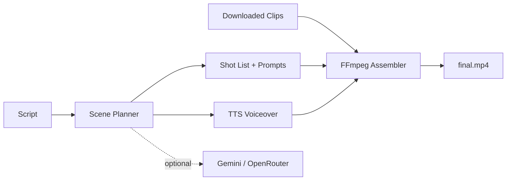

# ClipStitch

**Local AI-assisted video assembly for short-form content** — Python, Gradio, FFmpeg, TTS and LLM APIs.

Make 30+ second videos with free AI video generators that only give you
5-second clips. ClipStitch plans the scenes for you, generates the voiceover,
and stitches your downloaded clips into one finished video - no editing skills,
no paid subscriptions.

**Cost: $0. Everything runs on your computer using free services.**

## Projektüberblick (DE)

ClipStitch automatisiert die Vorbereitung kurzer Videos: Ein Skript wird in
Szenen aufgeteilt, für jede Szene wird ein Prompt erzeugt, die Voiceover-
Spur wird per TTS generiert und die heruntergeladenen KI-Clips werden mit
FFmpeg zu einem fertigen Video zusammengesetzt. Die Planung kann über einen
LLM-Anbieter (Gemini/OpenRouter) oder vollständig manuell erfolgen.

**Technischer Fokus:** Prompt-Planung, lokale Projektverwaltung, TTS-
Integration, FFmpeg-Assembly, Crossfades und ein browserbasiertes Gradio-UI.

## Architektur



---

## One-time setup (about 10 minutes)

You need three things installed:

1. **Python** - download from <https://python.org> (version 3.11 or newer).
   During install, TICK the box that says **"Add Python to PATH"**.
2. **FFmpeg** - open a terminal (PowerShell) and run:
   ```
   winget install Gyan.FFmpeg
   ```
3. **A free Gemini API key** *(optional but recommended)* - go to
   <https://aistudio.google.com>, sign in, click "Get API key", copy it.

## Starting ClipStitch

Double-click **`run.bat`** (Windows) or run `./run.sh` (Mac/Linux).

The first start installs everything automatically and takes a few minutes.
After that it starts in seconds and opens your browser at
<http://127.0.0.1:7860>.

In "AI provider settings" paste your Gemini key and click **Save API
settings** once. No key? Choose the `manual` provider instead - it just splits
the script where you leave blank lines.

## Making a video

### Step 1 - Plan
1. Type a project name (e.g. `ocean_doc`) and click **Open / Create**.
2. Paste your narration script into the **Script** box.
   *(Tip: ask any free AI chat to write one: 'Write a 30-second narration
   script about deep sea creatures.')*
3. Optionally describe a visual style, pick a voice, set how many seconds
   your clips are, choose vertical or landscape.
4. Click **Generate shot list + voiceover**.

ClipStitch splits the script into scenes, speaks each scene aloud, and shows
a table with one **prompt per scene** plus a preview of the full voiceover.

### Step 2 - Shoot (the human part)
For each scene in the table:
1. Copy the prompt into your AI video tool (Kling, Google Flow / Veo,
   Hailuo, Pika...). Use its *image-to-video* mode with a first-frame image
   of your character for consistent results between scenes.
2. Download the clip.
3. Drag all clips onto the **Shoot** tab, or copy them into the project's
   `clips` folder named exactly `scene_01.mp4`, `scene_02.mp4`, ...

The checklist turns green as each clip arrives. Clips can be shorter than
needed - ClipStitch holds the last frame; longer ones get trimmed.

### Step 3 - Assemble
Go to the **Assemble** tab and click **Build final video**. Optionally add a
music file first. You get `final.mp4` inside the project folder, with every
clip matched to its narration, smooth crossfades, and the mixed voiceover.

## Where files live

```
projects/
  ocean_doc/            <- one folder per video
    project.json        <- scenes + settings
    shot_list.md        <- printable list of prompts
    audio/scene_01.mp3  <- narration per scene
    clips/scene_01.mp4  <- your downloaded clips go here
    voiceover_preview.mp3
    final.mp4           <- the result
config.json             <- API keys (stays on your PC)
```

## Troubleshooting

| Problem | Fix |
| --- | --- |
| `ffmpeg not found` at startup | Run `winget install Gyan.FFmpeg`, then reopen |
| Voice generation fails | Check internet - voices come from Microsoft's free Edge TTS service |
| Scene planning fails | Check the API key, try again, or switch provider to `manual` |
| A clip looks wrong | Regenerate it in your video tool and replace `scene_XX.mp4` |
| Narration timing feels rushed | Increase "Extra hold after narration" and rebuild |

## Privacy & limits

- Scripts are sent only to the services you configure: Microsoft's free
  text-to-speech endpoint and the LLM you choose (Gemini / OpenRouter).
- Video clips never leave your computer.
- Free tiers have daily quotas; if a service refuses, wait or swap providers.
